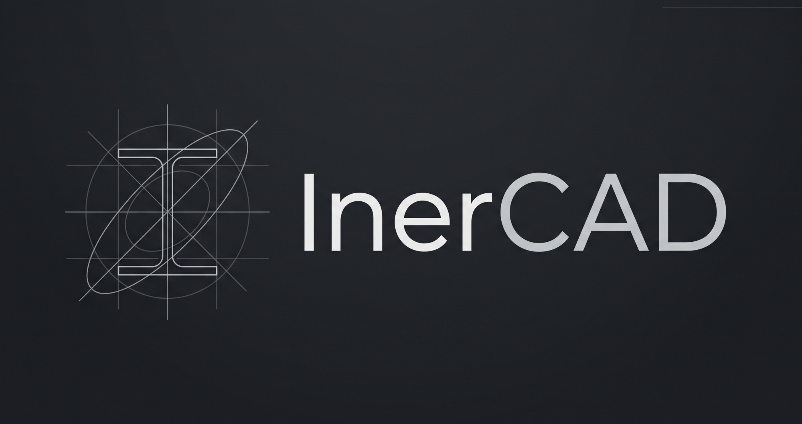

# InerCAD

Calculadora interactiva de **propiedades geométricas y momentos de inercia de secciones planas**.
Dibuja la sección con formas y perfiles, arrástrala, cambia sus medidas y obtén al instante área,
centroide, momentos de inercia, ejes principales, radios de giro y módulos resistentes.

No necesita instalación ni conexión: es una aplicación web que funciona abriendo un archivo.

## Cómo usarla

| Forma | Cómo |
|---|---|
| La más simple | Haz doble clic en [`index.html`](index.html) (se abre en tu navegador) |
| Un solo archivo para compartir | `node build.js` genera `dist/InerCAD.html` (HTML + CSS + JS en uno) |
| Servidor local | `npm start` → <http://localhost:5173> |
| Tests | `npm test` |

### Versión de escritorio para Windows (.exe)

Tras `npm run dist` se generan en `release/`:

| Archivo | Para qué |
|---|---|
| `InerCAD-Setup-1.0.0.exe` | Instalador (elige carpeta, acceso directo en el escritorio y en el menú Inicio, asocia los archivos `.inercad`) |
| `InerCAD-1.0.0-portable.exe` | Versión portátil: un solo ejecutable, sin instalar |

Es la misma interfaz que la versión web empaquetada con Electron. Aporta: ventana propia con icono, doble clic en un
`.inercad` para abrirlo, diálogo de guardado de Windows y **«Guardar PDF» directo** del informe.
Los archivos pesan ~100 MB porque incluyen el motor de Chromium. La versión 1.0.0 no está firmada digitalmente: la primera vez,
Windows SmartScreen puede avisar («Más información → Ejecutar de todas formas»). Ver [Firma de código](#firma-de-código).

Para desarrollar: `npm install` y después `npm run desktop` (abre la app), `npm run desktop:smoke` (prueba automática
de arranque + cálculo + PDF) y `npm run dist` (instalador y portátil). Si npm bloquea el script de instalación de
Electron, ejecuta `node node_modules/electron/install.js`. Los iconos y logotipos se regeneran con `npm run brand`.

El proyecto se **autoguarda** en el navegador. Con *Guardar* se descarga un archivo `.inercad` que se puede
volver a abrir (o arrastrar sobre la ventana).

## Sitio web y distribución

`npm run site` genera en `public/` el **sitio completo**, listo para subir a cualquier alojamiento estático:

| Ruta | Contenido |
|---|---|
| `/` | Portada: funciones, capturas reales, precisión, descargas con huella SHA-256 y preguntas frecuentes |
| `/guia.html` | Guía de uso completa |
| `/app/` | La aplicación web, **instalable como PWA** y con funcionamiento sin conexión (service worker) |
| `/descargas/` | Instalador, versión portátil y `SHA256SUMS.txt` |
| `404.html`, `robots.txt`, `sitemap.xml`, `_headers`, `vercel.json` | Páginas y ajustes para el alojamiento |

Los instaladores pesan unos 100 MB, por encima del límite de archivo de varios alojamientos gratuitos (GitHub y Vercel, 100 MB).
Por eso hay dos recetas:

```bash
# 1) Todo en un mismo servidor (nginx, IIS, un VPS, Netlify con límite alto…)
npm run site -- --site-url=https://tu-dominio.com

# 2) Sitio en un alojamiento estático + instaladores en GitHub Releases
npm run site:web -- --site-url=https://USUARIO.github.io/REPO --base=/REPO/ \
  --download-base=https://github.com/USUARIO/REPO/releases/download/v1.0.0/
```

Opciones de `tools/build-site.js`: `--site-url` (activa canonical, `og:image` absoluta y sitemap), `--base` (ruta base si el sitio
no está en la raíz), `--download-base` (prefijo de los enlaces de descarga, relativo o absoluto) y `--no-installers` (no copia los
`.exe` a `public/descargas`). El sitio se previsualiza con `node serve.js 5180 public`.

Para una versión nueva: subir el número de `package.json`, `npm run dist` (instalador y portátil) y `npm run site`. Las capturas del
sitio se regeneran con `npm run screenshots` (abre la propia aplicación y la captura a 2×).

El instalador de Windows (NSIS) es **por usuario** (sin permisos de administrador), deja elegir la carpeta, crea accesos directos,
asocia los `.inercad` y se desinstala limpiamente. La firma de código se hace en GitHub Actions con SignPath (ver
[Firma de código](#firma-de-código)); las compilaciones locales con `npm run dist` salen sin firmar.

### Publicación en GitHub (Pages + Releases)

El repositorio incluye tres flujos de GitHub Actions (`.github/workflows/`):

- **Pruebas** (`ci.yml`): en cada `push` a `main` y en cada *pull request* ejecuta `npm test` y comprueba que la aplicación y el sitio se generan.
- **Publicar versión** (`release.yml`): al subir una etiqueta `vX.Y.Z` (que debe coincidir con la versión de `package.json`), construye en Windows
  el instalador y la versión portátil, crea la **Release** con ambos y `SHA256SUMS.txt`, genera el sitio con los enlaces de descarga reales
  (y sus huellas) y lo publica en **GitHub Pages**. Si SignPath está configurado, firma antes los ejecutables (ver
  [Firma de código](#firma-de-código)).
- **Publicar sitio** (`sitio.yml`): cuando cambia la web en `main` (portada, guía, textos legales o app web), la vuelve a
  publicar en Pages con los instaladores de la versión ya publicada, sin crear una versión nueva.

Ajuste único: en *Settings → Pages → Build and deployment → Source*, elegir **GitHub Actions**. La web se publica en
**https://inercad.es** (dominio propio configurado en *Settings → Pages*); los flujos leen el dominio y la ruta base de esa
configuración, así que sin dominio propio vuelven solos a `USUARIO.github.io/REPO`.

Para publicar una versión nueva:

```bash
# 1) subir "version" en package.json y comprobar
npm test
# 2) confirmar, etiquetar y subir
git commit -am "Versión 1.0.1"
git tag v1.0.1
git push origin main --tags
```

### Firma de código

**Code signing policy:** [inercad.es/firma.html](https://inercad.es/firma.html)

Free code signing provided by [SignPath.io](https://about.signpath.io), certificate by [SignPath Foundation](https://signpath.org)

| Función | Miembros |
| --- | --- |
| Autores y revisores | [joanbibi](https://github.com/joanbibi) |
| Aprobadores | [joanbibi](https://github.com/joanbibi) |

**Privacidad:** este programa no transfiere ninguna información a otros sistemas en red, salvo que lo pida expresamente el usuario
o la persona que lo instala o lo utiliza.

Cómo funciona: `release.yml` construye la aplicación, envía `InerCAD.exe` a SignPath, empaqueta el instalador y la versión
portátil con ese ejecutable ya firmado y envía también los dos instaladores. Cada solicitud de firma se aprueba a mano en SignPath.
El generador del sitio detecta si los instaladores llevan firma y adapta los avisos de la web.
Las configuraciones de artefacto que usa SignPath están en [`.signpath/`](.signpath/).

Activación, una vez aprobado el proyecto en SignPath Foundation (en *Settings → Secrets and variables → Actions*):

| Tipo | Nombre | Valor |
| --- | --- | --- |
| Secreto | `SIGNPATH_API_TOKEN` | Token de API de SignPath con permiso para enviar solicitudes |
| Variable | `SIGNPATH_ORGANIZATION_ID` | ID de la organización en SignPath |
| Variable | `SIGNPATH_PROJECT_SLUG` | *(opcional)* proyecto; por defecto `inercad` |
| Variable | `SIGNPATH_SIGNING_POLICY_SLUG` | *(opcional)* política; por defecto `release-signing` (para probar, `test-signing`) |

Sin `SIGNPATH_ORGANIZATION_ID` o sin el token, el flujo publica igual que antes, sin firmar.

### Tablas y fichas de perfiles

`tools/profile-pages.js` genera en `public/perfiles/` una ficha por cada perfil del catálogo (IPE, HEA, HEB, L, CHS, SHS, RHS),
una tabla por serie y un índice. Las propiedades (área, peso, inercias, módulos elásticos y plásticos, radios de giro y, en los
angulares, ejes principales) se calculan con el propio motor, así que coinciden siempre con la aplicación. Cada ficha enlaza a
`app/?perfil=<identificador>` (p. ej. `app/?perfil=ipe-300`), que abre ese perfil en la app web; el trabajo anterior se
recupera con *Deshacer*.

### Anuncios, textos legales y apoyo

La web puede mostrar anuncios de **Google AdSense** en las páginas de contenido (portada, guía y fichas de perfiles). **Nunca** en la app web (`/app/`) ni en el programa
de escritorio, que siguen sin conexiones ni anuncios. También tiene un **aviso legal**, una política de **privacidad y cookies**
y una sección **Apoyar** (`#apoyar`), enlazada desde la ayuda de la app y el menú *Ayuda* del programa.

Todo se configura con variables del repositorio (*Settings → Secrets and variables → Actions → Variables*); `tools/build-site.js`
las lee del entorno:

| Variable | Valor |
| --- | --- |
| `ADSENSE_CLIENT` | ID de editor de AdSense, `ca-pub-XXXXXXXXXXXXXXXX` |
| `LEGAL_TITULAR`, `LEGAL_NIF`, `LEGAL_DOMICILIO`, `LEGAL_EMAIL` | Datos del titular para el aviso legal (LSSI-CE, art. 10) |
| `APOYO_URL` | *(opcional)* página de donaciones (Ko-fi, GitHub Sponsors…) |

- Los anuncios solo se activan con un ID válido **y** los cuatro datos legales. Entonces se inserta el código de AdSense y se
  publica `ads.txt`; sin ellos, la web se genera sin anuncios y los textos lo reflejan.
- El consentimiento de cookies lo gestiona el mensaje de *Privacidad y mensajes* de AdSense (CMP certificada por Google,
  obligatoria en el EEE). En su configuración, usa `https://inercad.es/privacidad.html` como política de privacidad.
- Tras cambiar una variable, vuelve a publicar la web: *Actions → Publicar sitio → Run workflow*.

## Licencia

Código bajo licencia **MIT** (ver [`LICENSE`](LICENSE)). Las tipografías IBM Plex (SIL OFL 1.1) y las demás piezas de terceros se
detallan en [`THIRD_PARTY_NOTICES.md`](THIRD_PARTY_NOTICES.md).

## Qué hace

**Construir la sección**
- 11 formas básicas: rectángulo (con esquinas redondeadas), círculo, elipse, triángulo, trapecio, polígono
  regular, semicírculo, cuarto de círculo, sector, segmento circular y **polígono libre** (vértices con acuerdo opcional).
- 8 perfiles paramétricos: I/H, T, L, U, Z, cruz, tubo circular y tubo rectangular, con radios de acuerdo.
- **Catálogo normalizado**: IPE, HEA, HEB, angulares L de alas iguales, tubos CHS, SHS y RHS.
- Cualquier forma puede ser **material (+)** o **hueco (−)**.

**Modificar la geometría de forma intuitiva**
- Arrastra las formas; el imán las alinea con la rejilla y con los bordes/centros de las demás (guías rosas).
- Asas en el lienzo: cuadradas para cambiar el tamaño (el borde opuesto se queda fijo), circulares para
  espesores y ángulos, y un círculo superior para girar.
- Campos numéricos con **expresiones y unidades**: `12*5`, `2.5cm + 4mm`, `(3+4)/2`. Flechas ↑↓ para ajustar.
- Polígonos: arrastra vértices, crea vértices nuevos desde los puntos intermedios o edita sus coordenadas en una tabla.
- Selección múltiple, alinear, reflejar, duplicar, bloquear, ocultar, deshacer/rehacer ilimitado.
- Cotas en vivo, reglas, rejilla adaptativa, zoom con la rueda, tema claro/oscuro.

**Resultados** (se recalculan mientras arrastras)
- Área, centroide, dimensiones totales.
- `Ix`, `Iy`, `Ixy`, momento polar, momentos y ejes **principales**, radios de giro.
- Módulos resistentes **elásticos** (4 fibras) y **plásticos** con factor de forma y eje neutro plástico.
- Valores respecto a los ejes del origen, y respecto a **ejes de referencia u–v** arbitrarios (punto + ángulo,
  arrastrables en el lienzo) con **círculo de Mohr** interactivo.
- **Tabla de cálculo de Steiner** elemento a elemento.
- Superposiciones: centroide, ejes centroidales, ejes principales y elipse de inercia.
- Resultados en mm, cm, m, in o ft (independiente de la unidad de dibujo), notación y cifras configurables.

**Salidas**: informe imprimible / PDF, CSV, copiar al portapapeles (Excel), PNG, SVG y DXF.

## Precisión

El cálculo usa el **teorema de Green** sobre el contorno de cada forma (rectas y arcos elípticos) con
cuadratura de Gauss-Legendre: el resultado es exacto para polígonos, círculos, elipses y acuerdos, **sin
discretizar las curvas**. Los tests (`tests/engine.test.js`) comprueban:

- fórmulas cerradas de rectángulo, círculo, elipse, triángulo, semicírculo, cuarto, sector y segmento;
- composición con huecos y teorema de Steiner, giros y espejos, secciones muy alejadas del origen;
- **64 perfiles del catálogo (IPE, HEA, HEB y angulares L) contra los valores de las tablas** (desviación máxima 0,4 %, debida al
  redondeo de las tablas y a la geometría nominal);
- que las asas de edición no mueven lo que no se arrastra, también con la forma girada y reflejada.

Ejemplo: IPE 300 → A = 53,81 cm², Iy = 8 356 cm⁴, Iz = 603,8 cm⁴, Wpl,y = 628 cm³.

## Identidad visual

- **Logotipo**: la imagen original (`assets/logo/source.jpg`) se separa automáticamente en *símbolo* y *nombre*
  con fondo transparente. En la interfaz se pintan como máscaras, así que cambian de color con el tema.
  Las líneas del símbolo son muy finas: en tamaños pequeños (favicon, iconos de 16–64 px) se usa un
  glifo simplificado de la viga en I; de 128 px en adelante, el símbolo completo.
- **Tipografía**: IBM Plex Sans (300/400/500) para la interfaz, IBM Plex Mono para valores y tablas (cifras
  tabulares, cero con punto) e IBM Plex Serif cursiva para los símbolos (*I*ₓ, *θ*₁…). Tracking positivo en texto
  pequeño y mayúsculas, negativo en títulos grandes.
- **Colores**: blackstone `#212529` y whiteout `#E9ECEF` con grises afines.

## Convenciones

- Ejes cartesianos: x a la derecha, y hacia arriba. `Ix = ∫y² dA`, `Iy = ∫x² dA`, `Ixy = ∫x·y dA`.
- `θ₁` es el ángulo (antihorario desde x) del eje respecto al cual el momento es máximo (`I₁`); `I₂` es el mínimo.
- Los momentos se miden respecto a ejes **por el centroide G**, salvo los marcados «respecto al origen».
- Si dos formas de **material** se solapan, la zona común se cuenta dos veces (método de áreas compuestas).
  InerCAD lo detecta y lo marca en rojo; también avisa de huecos que sobresalen del material y de polígonos
  cuyo contorno se cruza.
- No se calcula la constante de torsión de Saint-Venant ni la de alabeo (sí el momento polar `Ix + Iy`).

## Atajos

`V` seleccionar · `H` o espacio mover la vista · `P` polígono · `F` ajustar (`Mayús+F` a la selección) ·
`G` rejilla · `S` imán · `Supr` eliminar · `Ctrl+Z/Y` deshacer/rehacer · `Ctrl+D` duplicar · `Ctrl+A` todo ·
`Ctrl+S` guardar · flechas para mover (`Mayús` ×10, `Alt` ÷10) · `Alt` al arrastrar desactiva el imán ·
`Mayús` al arrastrar restringe el eje / gira de 15° en 15° · `?` ayuda.

## Estructura

```
index.html          Interfaz de la aplicación
.github/workflows/  Pruebas y publicación automática (Release + Pages, con firma de código)
site/               Código fuente del sitio web (portada, guía, política de firma, aviso legal, privacidad, 404, estilos y capturas)
css/styles.css      Estilos (tema claro/oscuro, responsive)
css/fonts.css       @font-face de IBM Plex (generado por tools/fonts.js)
fonts/              IBM Plex Sans, Mono y Serif en woff2 (SIL OFL 1.1), empaquetadas: funciona sin conexión
assets/logo/        Imagen original (source.jpg) y sus piezas: símbolo, nombre y composición, claro y oscuro
js/engine.js        Motor: Green, acuerdos, secciones, tensor de inercia, módulo plástico
js/shapes.js        Formas paramétricas, asas de edición, análisis de la sección
js/profiles.js      Catálogo normalizado y ejemplos
js/util.js          Unidades, formato numérico, expresiones, iconos
js/state.js         Documento, selección, historial, autoguardado, avisos
js/view.js          Lienzo: dibujo e interacción
js/panels.js        Paleta, elementos, propiedades, resultados, ejes/Mohr, tabla
js/ui.js            Barra superior, menús, modales, atajos, ajustes
js/report.js        Informe, CSV, PNG, SVG, DXF
tests/              Tests del motor y de utilidades (Node, sin dependencias)
build.js, serve.js  Empaquetado a un solo archivo y servidor de desarrollo
electron/           Versión de escritorio (proceso principal y puente seguro)
tools/make-brand.js Separa el logotipo original en símbolo y nombre y genera iconos (Electron + JS puro)
tools/fonts.js      Copia las fuentes desde @fontsource y genera css/fonts.css
tools/build-site.js Genera el sitio completo en public/ (con la app como PWA y las descargas)
tools/profile-pages.js  Fichas y tablas de perfiles normalizados para el sitio
tools/make-screenshots.js  Capturas reales de la aplicación para el sitio
build/installer.nsh Ajustes del instalador de Windows (limpieza de la asociación de archivos)
.signpath/          Configuraciones de artefacto para la firma con SignPath
```

La aplicación en sí no tiene dependencias ni paso de compilación (JavaScript puro); Electron y electron-builder solo
se usan para generar el .exe.
